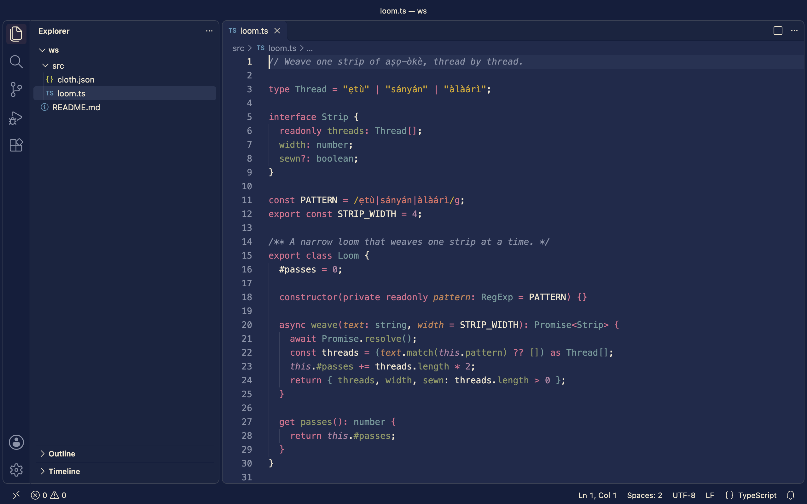
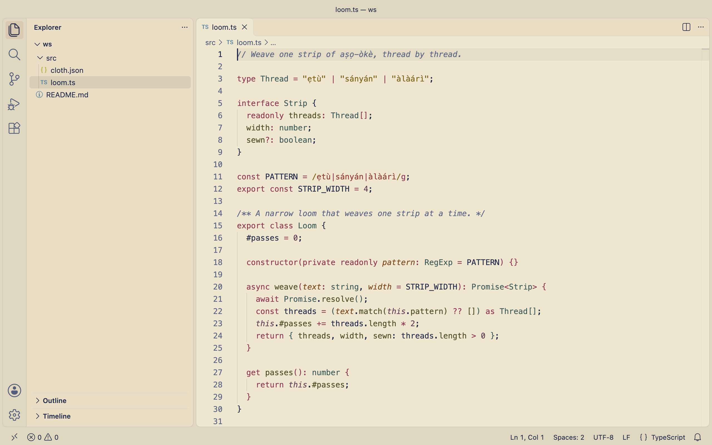

# Ilé-Ọ̀yọ́ Theme

**Ilé-Ọ̀yọ́** (Yoruba: *"home of Ọ̀yọ́"*) is a color theme named for Ọ̀yọ́, the
historic Yoruba city and empire. Its palette is woven from *aṣọ-òkè* (*aṣọ
òfì*), the hand-loomed cloth of Ọ̀yọ́'s *agbádá* and *ìró àti bùbá*: the deep
indigo of *ẹtù*, the warm beige of *sányán*, and the crimson of *àlàárì*,
finished with the red of coral beads, the shine of gold thread, and the earth
tones of the clay beneath them all. Warm, grounded, and made to be lived in,
like a home.

It comes in two variants:

| Variant | Meaning   | Mode  |
| ------- | --------- | ----- |
| **Alẹ́**  | evening   | Dark  |
| **Ọ̀sán** | afternoon | Light |

The palette started as the Ilé-Ọ̀yọ́ preset on [ayoola.io](https://ayoola.io).

## Supported applications

| Application | Get it |
| ----------- | ------ |
| Chrome | [`themes/chrome`](themes/chrome/) (Chrome Web Store coming soon) |
| CSS (web) | [npm `ile-oyo-theme`](https://www.npmjs.com/package/ile-oyo-theme) · [details](themes/css/) |
| Kate | [`themes/kate`](themes/kate/) (in GitHub Releases from v0.2.0) |
| Firefox | [`themes/firefox`](themes/firefox/) (addons.mozilla.org coming soon) |
| iTerm2 | [GitHub Releases](https://github.com/ayoolaao/ile-oyo-theme/releases) · [details](themes/iterm/) |
| Visual Studio Code | [Marketplace](https://marketplace.visualstudio.com/items?itemName=jazzykid.ile-oyo-theme) · [details](themes/vscode/) |
| Xcode | [`themes/xcode`](themes/xcode/) (in GitHub Releases from v0.2.0) |

More are on the way: Zsh, Typora, JetBrains, Terminal.app and
Notepad++.

## How it works

All colors are defined once in a single palette file. A build step generates
the theme for each application from that file, so every port stays in sync.
See [docs/architecture.md](docs/architecture.md) for the palette rules and
how each theme is generated.

## License

[Apache License 2.0](LICENSE). The names Ilé-Ọ̀yọ́, Alẹ́ and Ọ̀sán and the
icon identify this project; modified versions need their own name and icon
(see [NOTICE](NOTICE)).
