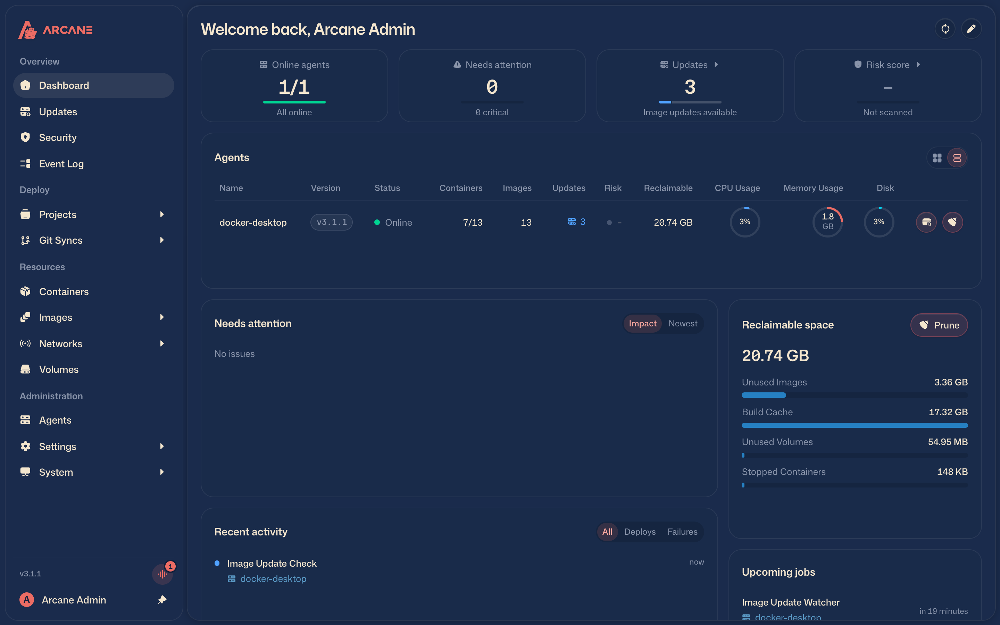
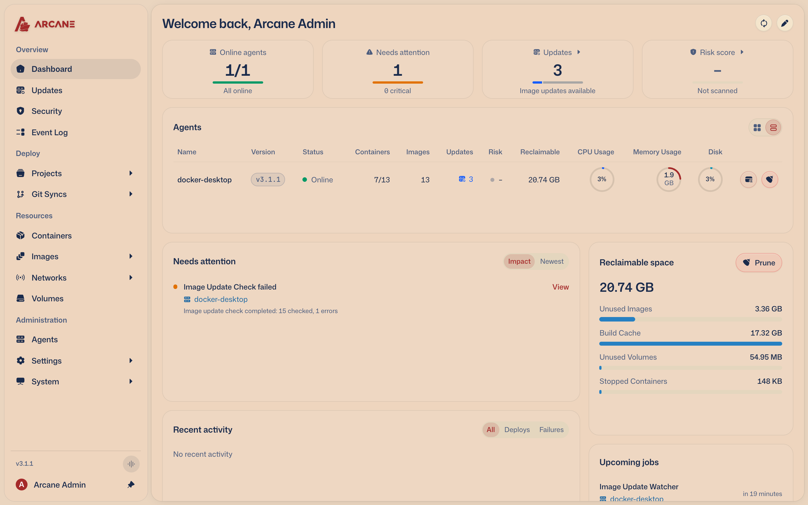

# Ilé-Ọ̀yọ́ for Arcane

An application theme for [Arcane](https://github.com/getarcaneapp/arcane), the
Docker manager. One theme with both variants; it follows Arcane's light/dark
mode:

| Arcane uses | Variant |
| ----------- | ------- |
| Light | **Ọ̀sán** (afternoon) |
| Dark | **Alẹ́** (evening) |

## Install

1. Download `ile-oyo-arcane.json` from
   [GitHub Releases](https://github.com/ayoolaao/ile-oyo-theme/releases), or
   use `ile-oyo.json` in this folder.
2. In Arcane, open **Settings → Appearance → Application Theme** and click
   **Import theme**.
3. Drop in the file (or paste its contents), then pick **Ilé-Ọ̀yọ́**.

Imported themes are saved to your Arcane account, so they follow you across
browsers. Leave **Accent color** on its default to keep the theme's àlàárì
red.

## What's in the theme

- Every Arcane theme token: page, cards, popovers, sidebar, buttons, inputs,
  borders, focus rings, and the code-editor syntax colors.
- Àlàárì red for primary buttons, the focus ring and the Arcane logo;
  ẹtù-indigo surfaces in Alẹ́ and sányán beige in Ọ̀sán.
- Every text color reaches WCAG AA contrast (4.5:1) against the surface it
  sits on.

`ile-oyo.json` is generated from `palette/ile-oyo.json` by `npm run build`.
Don't edit it by hand; change the palette and rebuild.
`npm run screenshot:arcane` retakes the screenshots in a throwaway Arcane
container (needs Docker); see the top of `scripts/screenshot-arcane.mjs`.
