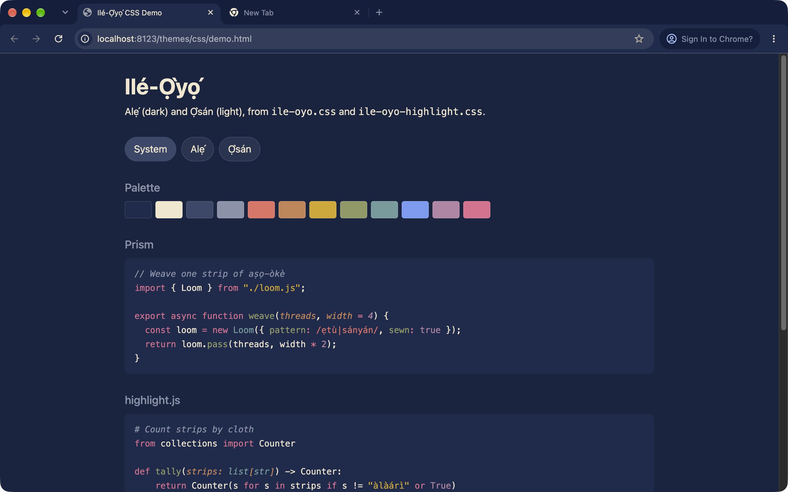
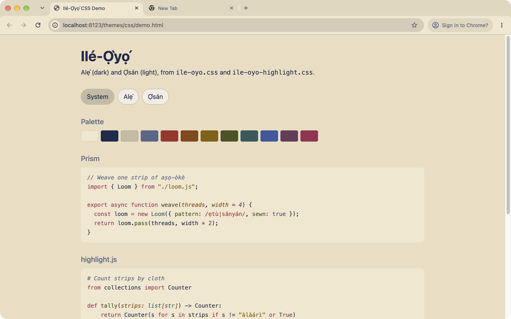

# Ilé-Ọ̀yọ́ for Chrome

Two themes, one per variant. Chrome themes can't switch with your system's
light/dark setting, so install the one you want:

| Folder | Variant |
| ------ | ------- |
| [`ale/`](ale/) | **Alẹ́** (evening, dark) |
| [`osan/`](osan/) | **Ọ̀sán** (afternoon, light) |

The page in the screenshots is the CSS theme's demo (`themes/css/demo.html`).

The themes also work in other Chromium browsers that accept Chrome themes,
such as Microsoft Edge and Brave.

## Install

From the Chrome Web Store: coming soon.

To use it before then, load it unpacked:

1. Get the theme: unzip `ile-oyo-chrome-ale-<version>.zip` or
   `ile-oyo-chrome-osan-<version>.zip` from
   [GitHub Releases](https://github.com/ayoolaao/ile-oyo-theme/releases), or use
   the `ale/` or `osan/` folder from a clone of this repo.
2. Open `chrome://extensions` and turn on **Developer mode**.
3. Click **Load unpacked** and select the folder.

To go back to Chrome's default, open Settings → Appearance → Theme → **Reset
to default**.

## What's in the theme

- The tab strip, selected and inactive tabs, toolbar, address bar, bookmarks
  bar and the new tab page.
- The same surfaces as the Firefox and VS Code themes, so they feel alike.
  Chrome has no color for a line on the selected tab, so there's no àlàárì-red
  line here.
- Incognito windows keep Chrome's own colors, so they still look different.
- Every text color reaches WCAG AA contrast (4.5:1) against its background.

`ale/manifest.json` and `osan/manifest.json` are generated from
`palette/ile-oyo.json` by `npm run build`; the icons by `npm run icon`. Don't
edit them by hand; change the palette and rebuild.
`npm run screenshot:chrome` retakes both screenshots in a separate Chrome with
a throwaway profile.
