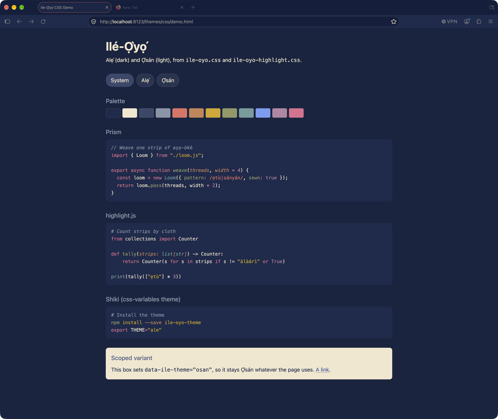
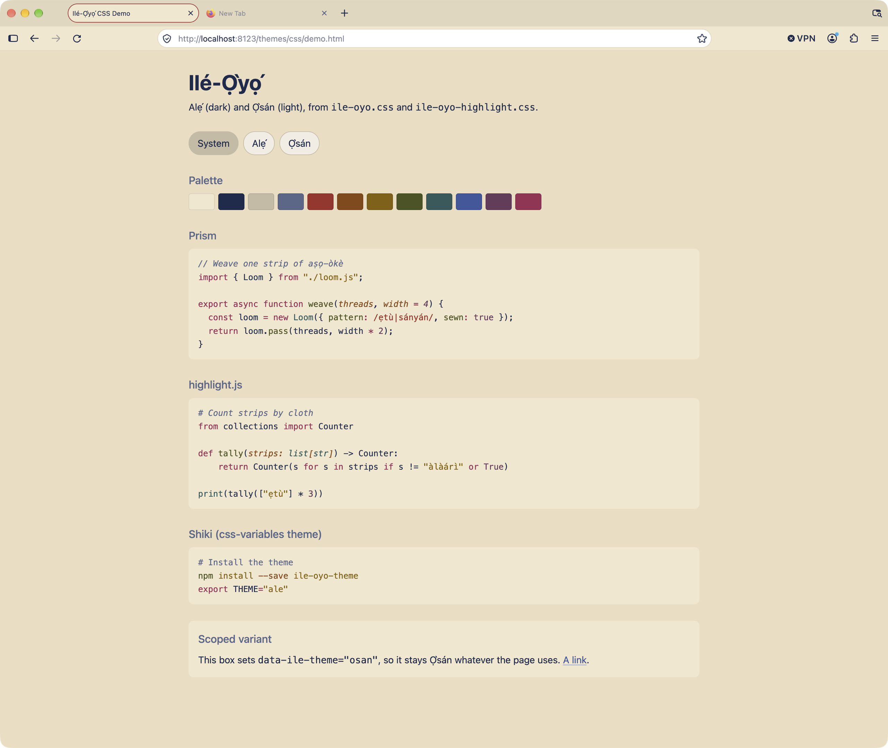

# Ilé-Ọ̀yọ́ for CSS

Color tokens for the web, plus syntax highlighting for Prism, highlight.js and
Shiki. Open [`demo.html`](demo.html) in a browser to see them.





The demo page in Alẹ́ (dark) and Ọ̀sán (light), shown in Firefox with the
Ilé-Ọ̀yọ́ Firefox theme.

| File | What it is |
| ---- | ---------- |
| `ile-oyo.css` | CSS variables (`--ile-*`) for both variants |
| `ile-oyo-highlight.css` | Code highlighting for Prism, highlight.js and Shiki; needs `ile-oyo.css` |
| `_ile-oyo.scss` | Sass variables and maps |
| `ile-oyo-tokens.js` / `.d.ts` | JS/TS tokens (ES module) |

## Install

```sh
npm install ile-oyo-theme
```

| Import | File |
| ------ | ---- |
| `ile-oyo-theme/css` | `ile-oyo.css` |
| `ile-oyo-theme/highlight.css` | `ile-oyo-highlight.css` |
| `ile-oyo-theme/scss` | `_ile-oyo.scss` |
| `ile-oyo-theme` | JS/TS tokens (ES module only) |

```js
import 'ile-oyo-theme/css';
import 'ile-oyo-theme/highlight.css';
import { ale, osan } from 'ile-oyo-theme';
```

Or copy the files from this folder.

## Variables

```html
<link rel="stylesheet" href="ile-oyo.css">
```

The page follows the system setting: **Ọ̀sán** (light) by default, **Alẹ́**
(dark) when the system is dark. To force a variant, set `data-ile-theme` on
`<html>` or on any element; it applies to that element and its children:

```html
<html data-ile-theme="ale">        <!-- always Alẹ́ -->
<aside data-ile-theme="osan">      <!-- this box is always Ọ̀sán -->
```

```css
body { background: var(--ile-bg); color: var(--ile-fg); }
a    { color: var(--ile-blue); }
```

Variables: `--ile-bg`, `--ile-fg`, `--ile-selection`, `--ile-comment`, the
accents (`--ile-red`, `-orange`, `-yellow`, `-green`, `-cyan`, `-blue`,
`-purple`, `-pink`), the UI scale (`--ile-ui-bg-darker`, `-bg-dark`,
`-bg-light`, `-bg-lighter`, `-float`), `--ile-line-highlight`,
`--ile-non-text`, `--ile-tab-drop-bg`, and `--ile-ansi-0` to `--ile-ansi-15`.

### Status colors

`--ile-error`, `--ile-warning`, `--ile-info` and `--ile-success` (the red,
yellow, blue and green accents) for status text and icons, each with a tinted
surface, `--ile-error-bg` and so on, for banners, badges and alerts. Put the
normal text color on the tinted surface and use the status color for its border
or icon; status-colored text on its own tint is below 4.5:1.

```css
.alert-error {
  background: var(--ile-error-bg);
  color: var(--ile-fg);
  border-left: 4px solid var(--ile-error);
}
.field-hint.is-invalid { color: var(--ile-error); }
```

## Syntax highlighting

```html
<link rel="stylesheet" href="ile-oyo.css">
<link rel="stylesheet" href="ile-oyo-highlight.css">
```

- **Prism** and **highlight.js**: load the file instead of a Prism or
  highlight.js theme. It styles their token classes.
- **Shiki**: use Shiki's CSS-variables theme; this file sets the `--shiki-*`
  variables it reads.

  ```js
  import { createHighlighter, createCssVariablesTheme } from 'shiki';
  const theme = createCssVariablesTheme({ name: 'css-variables', variablePrefix: '--shiki-' });
  const highlighter = await createHighlighter({ themes: [theme], langs: ['javascript'] });
  ```

All highlighting colors come from the variables, so code blocks switch with
the active variant.

## Sass

```scss
@use 'sass:map';
@use 'ile-oyo' as ile;

.note { color: ile.$ile-ale-yellow; }
.card { background: map.get(ile.$ile-oyo, 'osan', 'bg'); }
.warn { background: map.get(ile.$ile-osan, 'warning-bg'); border-color: ile.$ile-osan-warning; }
```

Every variable is `!default`, so you can override it before `@use ... with (...)`.

## JavaScript / TypeScript

```js
import { ale, osan, syntax, status } from 'ile-oyo-theme';

ale.colors.bg;              // "#1A2B4C"
osan.ansi[1];               // ANSI red in Ọ̀sán
ale.colors[syntax.keyword]; // the keyword color in Alẹ́
ale.status.warning;         // the warning color in Alẹ́ (same as ale.colors[status.warning])
osan.status.errorBg;        // tinted surface for an error banner in Ọ̀sán
```

These files are generated from `palette/ile-oyo.json` by `npm run build`.
Don't edit them by hand; change the palette and rebuild. `demo.html` is
hand-written.

## License

Apache License 2.0. See `LICENSE` and `NOTICE`; the Ilé-Ọ̀yọ́ name and icon
are not licensed for modified versions.
