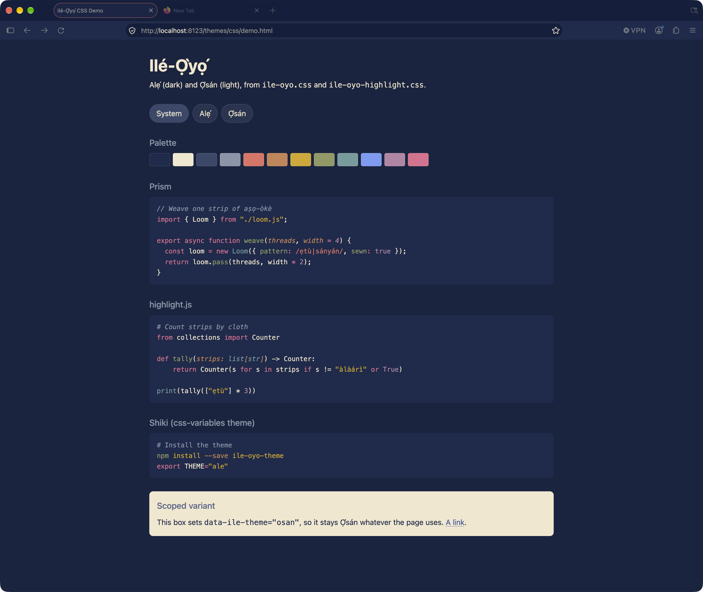
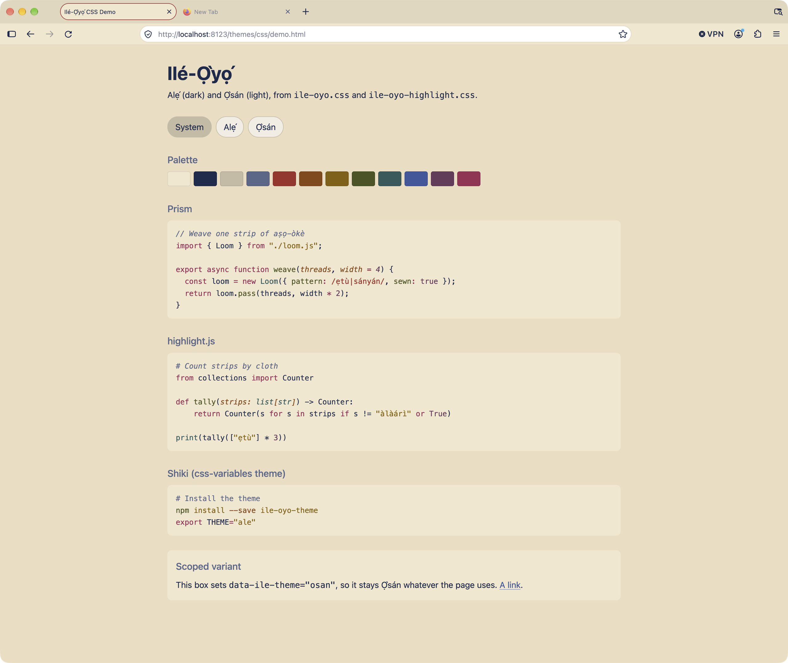

# Ilé-Ọ̀yọ́ for Firefox

One theme with both variants. Firefox switches between them with your system's
light/dark setting (or Firefox's **Website appearance** setting):

| Firefox uses | Variant |
| ------------ | ------- |
| Light | **Ọ̀sán** (afternoon) |
| Dark | **Alẹ́** (evening) |

The page in the screenshots is the CSS theme's demo (`themes/css/demo.html`).

## Install

From addons.mozilla.org: coming soon.

To try it before then, load it as a temporary add-on (removed when Firefox
quits):

1. Open `about:debugging#/runtime/this-firefox`.
2. Click **Load Temporary Add-on…** and select `manifest.json` in this folder.

## What's in the theme

- The tab strip, selected and inactive tabs (with an àlàárì-red line on the
  selected tab), toolbar, address bar and its dropdown, menus and popups,
  sidebar, and the new tab page.
- The same surfaces as the VS Code theme, so the two feel alike.
- Every text color reaches WCAG AA contrast (4.5:1) against its background.

`manifest.json` is generated from `palette/ile-oyo.json` by `npm run build`.
Don't edit it by hand; change the palette and rebuild. `npm run lint:firefox`
runs Mozilla's add-on linter on this folder. `npm run screenshot:firefox --
ale` (or `osan`) retakes a screenshot; see the steps at the top of
`scripts/screenshot-firefox.sh`.
