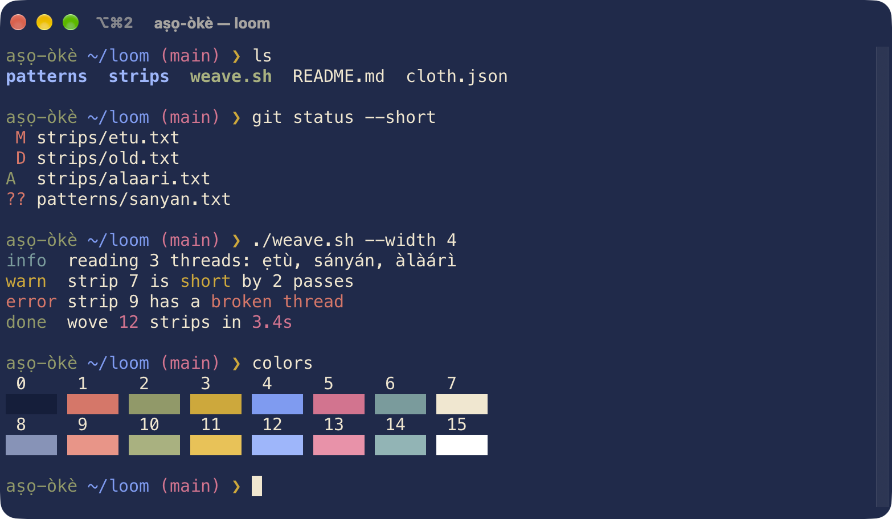
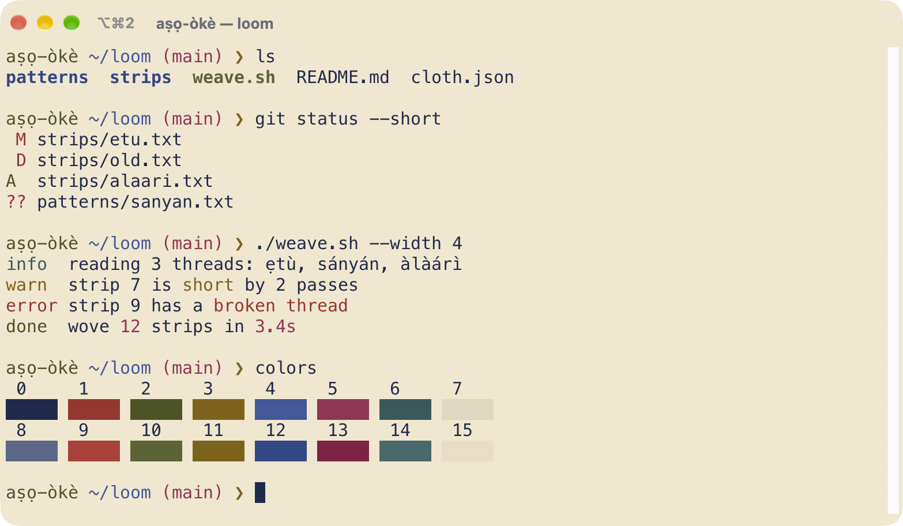

# Ilé-Ọ̀yọ́ for iTerm2

Two color presets:

| File | Variant |
| ---- | ------- |
| `Ile-Oyo-Ale.itermcolors` | **Alẹ́** (evening), dark |
| `Ile-Oyo-Osan.itermcolors` | **Ọ̀sán** (afternoon), light |

## Install

1. Download the `.itermcolors` file you want (or clone this repo).
2. In iTerm2, open **Settings → Profiles → Colors**.
3. Open the **Color Presets…** menu (bottom right) and choose **Import…**.
4. Select the file.
5. Choose **Ile-Oyo-Ale** or **Ile-Oyo-Osan** from **Color Presets…**.

Double-clicking a `.itermcolors` file in Finder also imports it.

## What's in each preset

- ANSI colors 0–15, background, foreground, bold, cursor, cursor text,
  selection, selected text, link, and cursor guide.
- Colors use the sRGB color space, so iTerm shows the exact palette values.

These files are generated from `palette/ile-oyo.json` by `npm run build`.
Don't edit them by hand; change the palette and rebuild.
`npm run screenshot:iterm` retakes the screenshots above.
