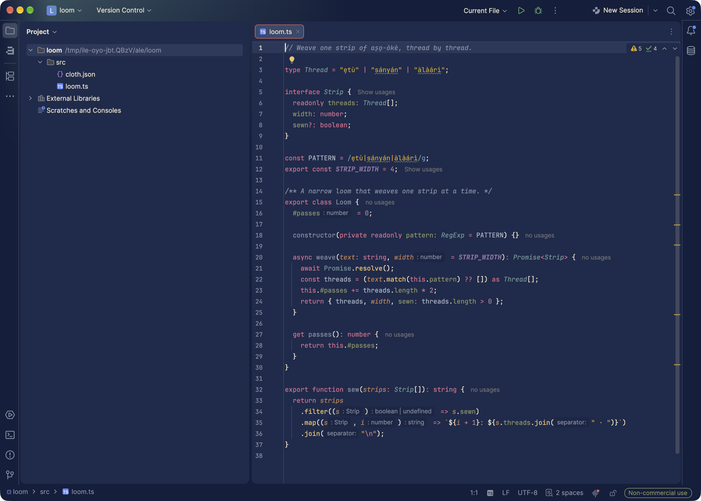
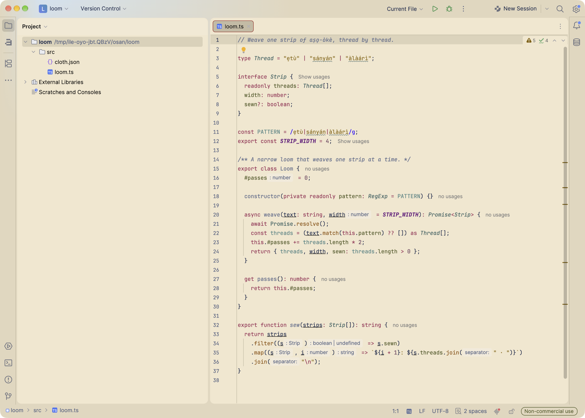
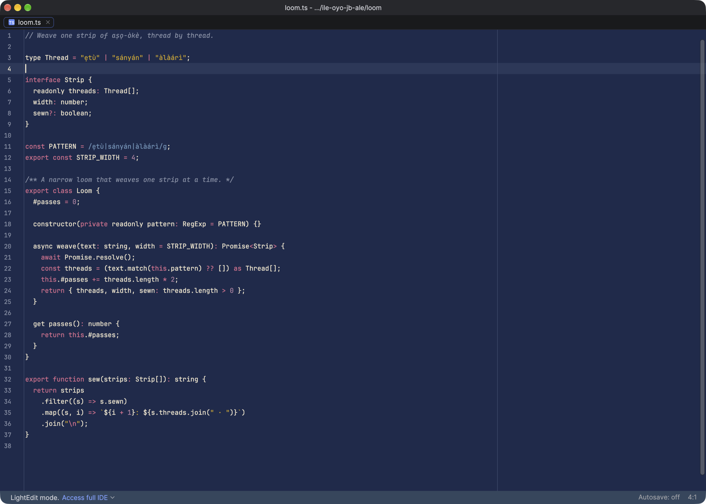
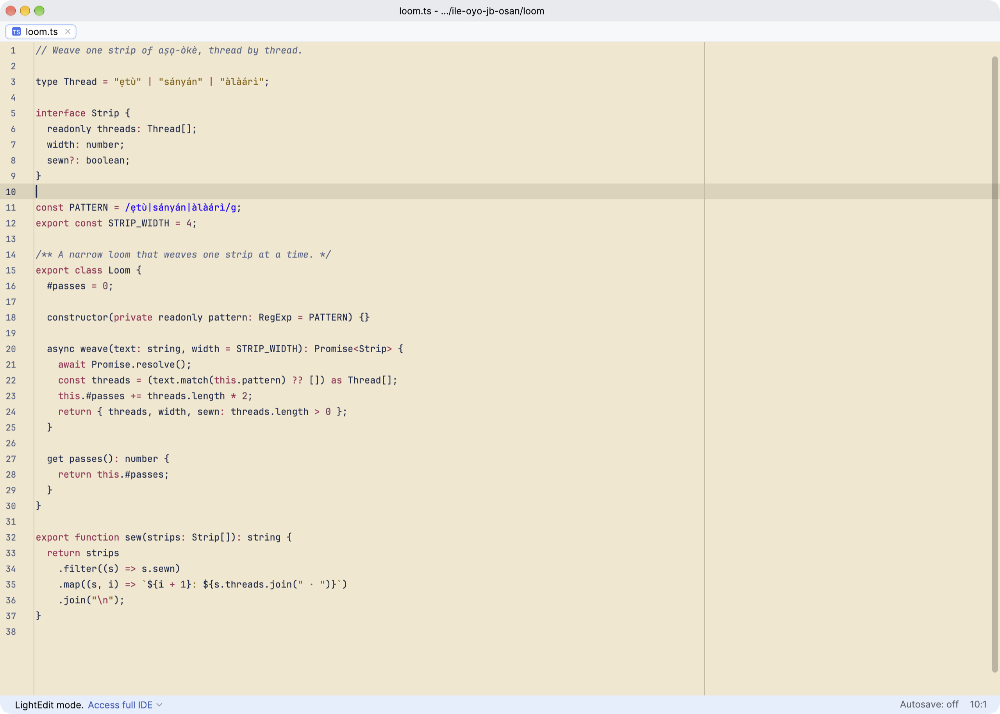

# Ilé-Ọ̀yọ́ for JetBrains IDEs

For IntelliJ IDEA, PyCharm, WebStorm and every other JetBrains IDE, in two
forms:

- **The IDE theme** (a plugin, recommended): colors the whole IDE (window,
  tool windows, tabs, menus, popups, controls) and the editor. Needs 2025.3 or
  later.
- **The editor color schemes** (`.icls`): the editor and console only, for any
  version.

## IDE theme

1. Download `ile-oyo-jetbrains-<version>.jar` from
   [GitHub Releases](https://github.com/ayoolaao/ile-oyo-theme/releases).
2. In the IDE, open **Settings → Plugins**, click the **⚙** (gear) →
   **Install Plugin from Disk…** and select the `.jar`.
3. In **Settings → Appearance & Behavior → Appearance → Theme**, pick
   **Ilé-Ọ̀yọ́ Alẹ́** or **Ilé-Ọ̀yọ́ Ọ̀sán**. The matching editor scheme comes
   with it.

The theme builds on JetBrains' Islands look and changes only colors: shapes,
spacing and icons stay JetBrains'. The islands (editor, tool windows,
dialogs) sit on the background color, the window frame around them on the
darker one, and the selected tab is underlined in red. Text reaches WCAG AA
contrast (4.5:1) on every surface the theme sets. The plugin's files are in
[`plugin/`](plugin/), generated by `npm run build`.

## Editor color schemes

| File | Scheme | Variant |
| ---- | ------ | ------- |
| `Ile-Oyo-Ale.icls` | Ilé-Ọ̀yọ́ Alẹ́ | **Alẹ́** (evening, dark) |
| `Ile-Oyo-Osan.icls` | Ilé-Ọ̀yọ́ Ọ̀sán | **Ọ̀sán** (afternoon, light) |

The screenshots show WebStorm with the Islands Dark and Islands Light looks.

### Install

1. Download `Ile-Oyo-Ale.icls` and/or `Ile-Oyo-Osan.icls` from
   [GitHub Releases](https://github.com/ayoolaao/ile-oyo-theme/releases), or
   use the files in this folder.
2. In the IDE, open **Settings → Editor → Color Scheme**.
3. Click the **⚙** (gear) next to the scheme list → **Import Scheme…** and
   select a `.icls` file.
4. Pick **Ilé-Ọ̀yọ́ Alẹ́** or **Ilé-Ọ̀yọ́ Ọ̀sán** as the scheme and click **OK**.

These schemes color the editor and console. The rest of the IDE (tool
windows, tabs, menus) keeps its look: use a dark look (Islands Dark,
Darcula) with Alẹ́ and a light one (Islands Light) with Ọ̀sán, or install the
IDE theme above instead.

### What's in the scheme

- Every language-default color (keywords, strings, numbers, functions,
  types, parameters, fields, comments, doc comments, markup), so all
  languages are covered, mapped to the same syntax roles as the VS Code,
  Xcode and Kate themes. Language-specific colors follow the defaults.
- The editor: caret and current line, selection, line numbers, guides,
  change markers, file status colors, errors and warnings, search and caret
  highlights, matching braces, links, TODO, inlay hints, breakpoints.
- The console's 16 ANSI colors, the same as the iTerm2 and Terminal.app
  presets.
- Alẹ́ is based on IntelliJ's Darcula scheme and Ọ̀sán on its Default (light)
  scheme, so anything the scheme doesn't set falls back to those.
- Every syntax color reaches WCAG AA contrast (4.5:1) on the background, and
  text stays at 4.5:1 on every highlight and inlay background.

The `.icls` files are generated from `palette/ile-oyo.json` by
`npm run build`. Don't edit them by hand; change the palette and rebuild.
`npm run screenshot:jetbrains -- open ale` (then `capture ale`; the same for
`osan`) retakes a scheme screenshot in WebStorm with a throwaway config, so
your own IDE settings aren't touched; see the steps at the top of
`scripts/screenshot-jetbrains.sh`. `npm run screenshot:jetbrains-theme` retakes
both IDE theme screenshots the same way.
