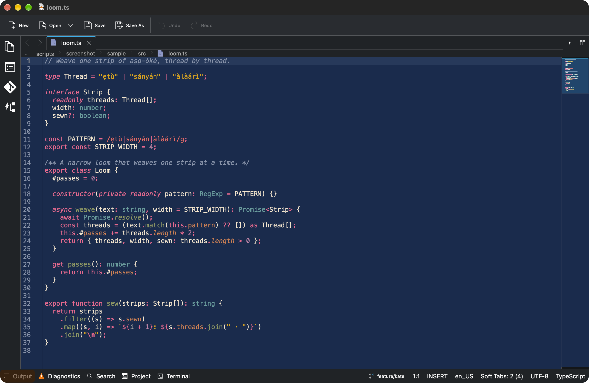
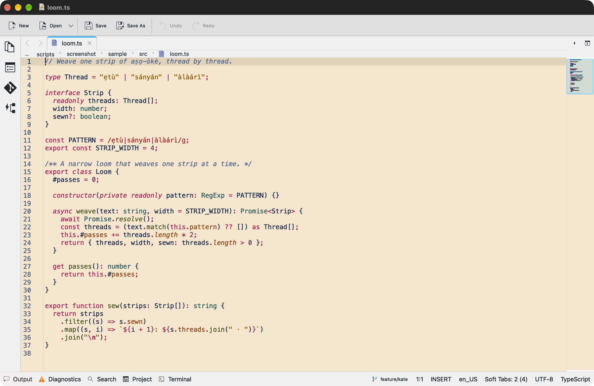

# Ilé-Ọ̀yọ́ for Kate

Editor color themes for Kate, one per variant. The same files work in KWrite,
KDevelop and other apps that use KDE's syntax-highlighting framework.

| File | Variant |
| ---- | ------- |
| `ile-oyo-ale.theme` | **Alẹ́** (evening, dark) |
| `ile-oyo-osan.theme` | **Ọ̀sán** (afternoon, light) |

## Install

1. Download `ile-oyo-ale.theme` and/or `ile-oyo-osan.theme` from
   [GitHub Releases](https://github.com/ayoolaao/ile-oyo-theme/releases), or
   use the files in this folder.
2. In Kate, open **Settings → Configure Kate…** (on macOS: **Kate →
   Settings…**) → **Color Themes**.
3. Click **Import…** and select a `.theme` file. Repeat for the other one.
4. Pick **Ilé-Ọ̀yọ́ Alẹ́** or **Ilé-Ọ̀yọ́ Ọ̀sán** as the default theme. With
   "Follow System Color Scheme", Kate picks a theme from your system's light
   or dark setting instead.

Or copy the files into Kate's theme folder and restart Kate:

| System | Folder |
| ------ | ------ |
| Linux | `~/.local/share/org.kde.syntax-highlighting/themes/` |
| macOS | `~/Library/Application Support/org.kde.syntax-highlighting/themes/` |
| Windows | `%LOCALAPPDATA%\org.kde.syntax-highlighting\themes\` |

The theme colors the editor. Kate's toolbars and panels follow the window
color scheme (**Settings → Window Color Scheme**); the screenshots use Breeze
Dark with Alẹ́ and Breeze Light with Ọ̀sán.

## What's in the theme

- All 31 of KDE's text styles and 28 editor colors (selection, current line,
  search and replace highlights, bracket matching, line numbers, change
  markers, bookmarks and breakpoints, spell checking).
- Syntax colors follow the same roles as the VS Code and Xcode themes;
  comments are italic and TODO/FIXME bold red.
- Every text color reaches WCAG AA contrast (4.5:1) against the background.

The `.theme` files are generated from `palette/ile-oyo.json` by
`npm run build`. Don't edit them by hand; change the palette and rebuild.
`npm run screenshot:kate` retakes both screenshots (quit Kate first); it puts
Kate's settings back as it found them.
