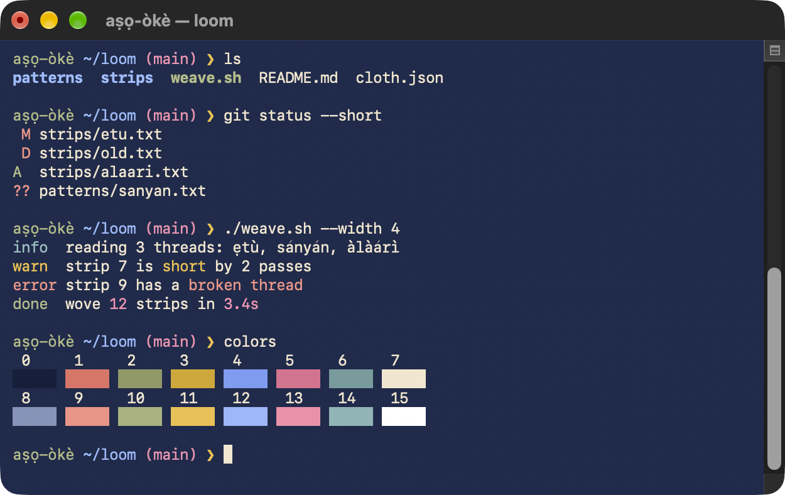
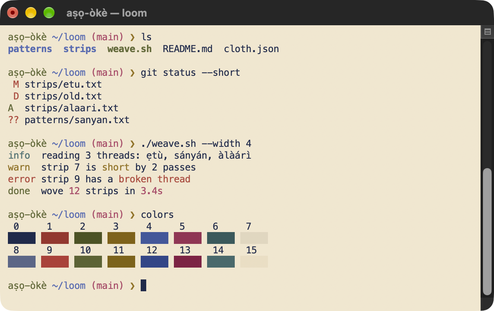

# Ilé-Ọ̀yọ́ for Terminal.app

Profiles for macOS Terminal, one per variant, with the same colors as the
iTerm2 presets.

| File | Variant |
| ---- | ------- |
| `Ile-Oyo-Ale.terminal` | **Alẹ́** (evening, dark) |
| `Ile-Oyo-Osan.terminal` | **Ọ̀sán** (afternoon, light) |

## Install

1. Download `Ile-Oyo-Ale.terminal` and/or `Ile-Oyo-Osan.terminal` from
   [GitHub Releases](https://github.com/ayoolaao/ile-oyo-theme/releases), or
   use the files in this folder.
2. Double-click a file. Terminal adds the profile (named `Ile-Oyo-Ale` or
   `Ile-Oyo-Osan`) and opens a window with it. Or: Terminal → Settings →
   Profiles → **…** (More) → **Import…**.
3. To use it for new windows, select it in Settings → Profiles and click
   **Default**.

The profiles set colors only: your font, window size and shell settings stay
as they are.

## What's in the profile

- Background, text, bold text, cursor and selection colors.
- All 16 ANSI colors, the same as the iTerm2 presets, so command-line tools
  look the same in both terminals.
- Text reaches WCAG AA contrast (4.5:1) on the background and on the
  selection.

The `.terminal` files are generated from `palette/ile-oyo.json` by
`npm run build`. Don't edit them by hand; change the palette and rebuild.
Terminal stores colors as archived `NSColor` objects; the build writes them
in sRGB without Apple tools, and on macOS the tests decode every color with
`NSKeyedUnarchiver` to check it. `npm run screenshot:terminal` retakes the
screenshots (quit Terminal first); it restores your Terminal settings
afterwards.
