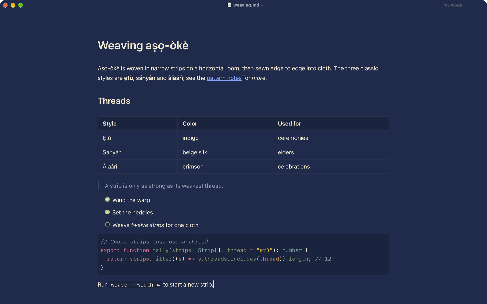
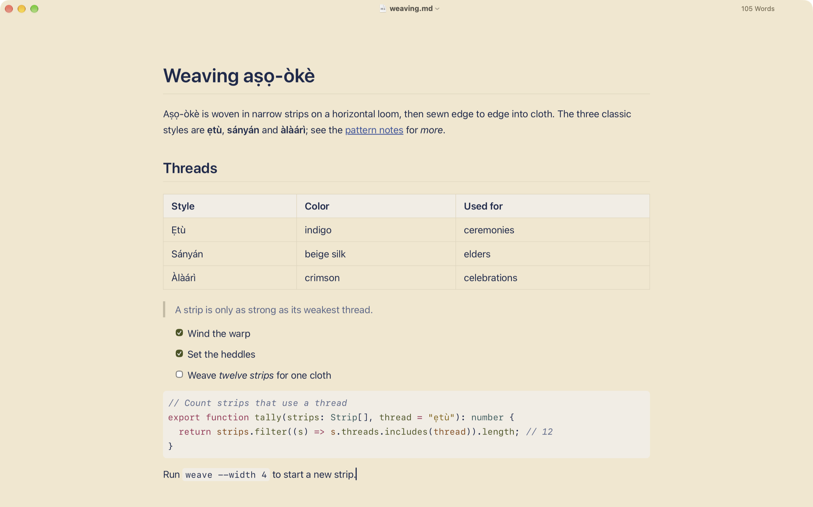

# Ilé-Ọ̀yọ́ for Typora

Themes for the Typora Markdown editor, one per variant.

| File | Shows in Typora as | Variant |
| ---- | ------------------ | ------- |
| `ile-oyo-ale.css` | Ile Oyo Ale | **Alẹ́** (evening, dark) |
| `ile-oyo-osan.css` | Ile Oyo Osan | **Ọ̀sán** (afternoon, light) |

## Install

1. Download `ile-oyo-ale.css` and/or `ile-oyo-osan.css` from
   [GitHub Releases](https://github.com/ayoolaao/ile-oyo-theme/releases), or
   use the files in this folder.
2. In Typora, open **Settings → Appearance → Open Theme Folder** and copy the
   files there.
3. Restart Typora, then pick **Ile Oyo Ale** or **Ile Oyo Osan** from the
   **Themes** menu.

On macOS you can use both: in Settings → Appearance, turn on **Use separate
theme in dark mode** and pick Ile Oyo Osan for light and Ile Oyo Ale for dark.

## What's in the theme

- The document: headings, links, lists and task lists, quotes, tables,
  inline code, footnotes, front matter, table of contents and GitHub-style
  alerts (note, tip, important, warning, caution).
- Code blocks colored with the same syntax roles as the VS Code, Xcode and
  Kate themes, and Markdown source mode.
- Typora's own interface: sidebar, file list and outline (the open file is
  marked in àlàárì red), search, menus, dialogs and tooltips.
- Every text color reaches WCAG AA contrast (4.5:1) against each background
  it's used on.

The `.css` files are generated from `palette/ile-oyo.json` by `npm run build`.
Don't edit them by hand; change the palette and rebuild. To adjust a theme
for yourself, use Typora's `ile-oyo-ale.user.css` (see Typora's
[custom CSS](https://support.typora.io/Add-Custom-CSS/) guide) so updates
don't overwrite your changes. `npm run screenshot:typora` retakes the
screenshots (quit Typora first); it restores your Typora settings afterwards.
