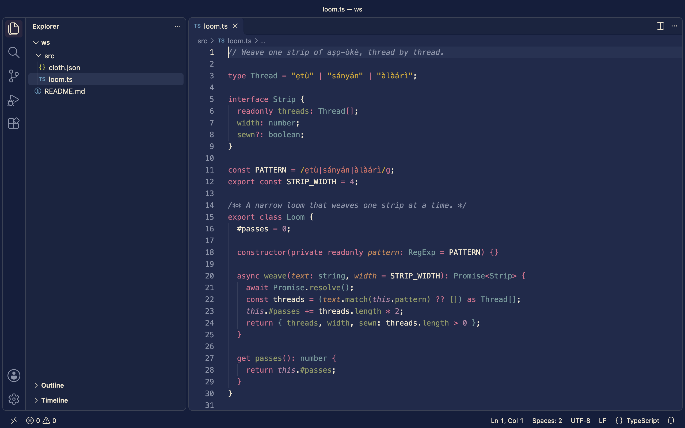
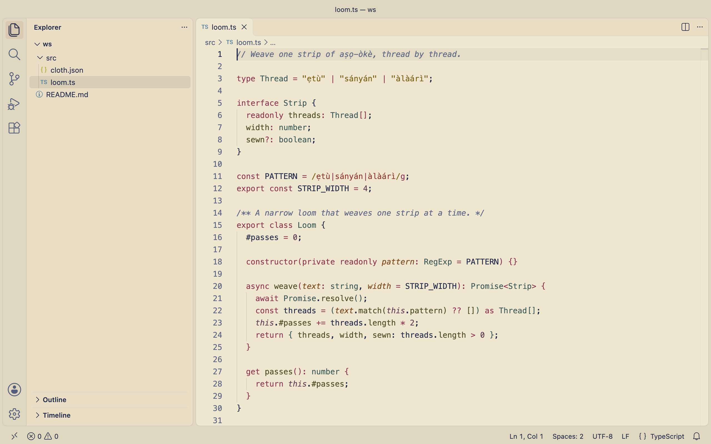

# Ilé-Ọ̀yọ́ for Visual Studio Code

*Home of Ọ̀yọ́.* A color theme woven from *aṣọ-òkè*: the indigo of *ẹtù*, the
beige of *sányán*, and the crimson of *àlàárì*.

| Theme | Variant |
| ----- | ------- |
| **Ilé-Ọ̀yọ́ Alẹ́** | evening, dark |
| **Ilé-Ọ̀yọ́ Ọ̀sán** | afternoon, light |

**Alẹ́**



**Ọ̀sán**



Every text color meets WCAG 2.1 AA contrast (4.5:1) against its background.

## Install

**From the Marketplace:** search for **Ilé-Ọ̀yọ́** in the Extensions view, or
run:

```sh
code --install-extension jazzykid.ile-oyo-theme
```

**From a `.vsix` file** (attached to each GitHub release, or built with
`npm run package:vscode`):

```sh
code --install-extension ile-oyo-theme-0.1.1.vsix
```

**From this repository:**

1. Copy or link this folder into your VS Code extensions folder:

   ```sh
   ln -s "$PWD/themes/vscode" ~/.vscode/extensions/ile-oyo-theme
   ```

2. Restart VS Code.

Then run **Preferences: Color Theme** (`⌘K ⌘T` / `Ctrl+K Ctrl+T`) and pick
**Ilé-Ọ̀yọ́ Alẹ́** or **Ilé-Ọ̀yọ́ Ọ̀sán**.

To match your system's light/dark setting, add to `settings.json`:

```json
"window.autoDetectColorScheme": true,
"workbench.preferredDarkColorTheme": "Ilé-Ọ̀yọ́ Alẹ́",
"workbench.preferredLightColorTheme": "Ilé-Ọ̀yọ́ Ọ̀sán"
```

## Development

The files in `themes/` are generated from `palette/ile-oyo.json` by
`npm run build` at the repository root. Don't edit them by hand.

`npm run screenshot:vscode` retakes the screenshots above in a throwaway VS
Code profile (macOS). They are linked from `main`, so they update on the
Marketplace when the new images reach `main`.

From the repository root: `npm run package:vscode` runs the tests and writes
`dist/ile-oyo-theme-<version>.vsix`; `npm run publish:vscode` publishes to the
Marketplace (needs a `vsce login` for the `publisher` in `package.json`).

## License

Apache License 2.0. See `LICENSE` and `NOTICE`; the Ilé-Ọ̀yọ́ name and icon
are not licensed for modified versions.
