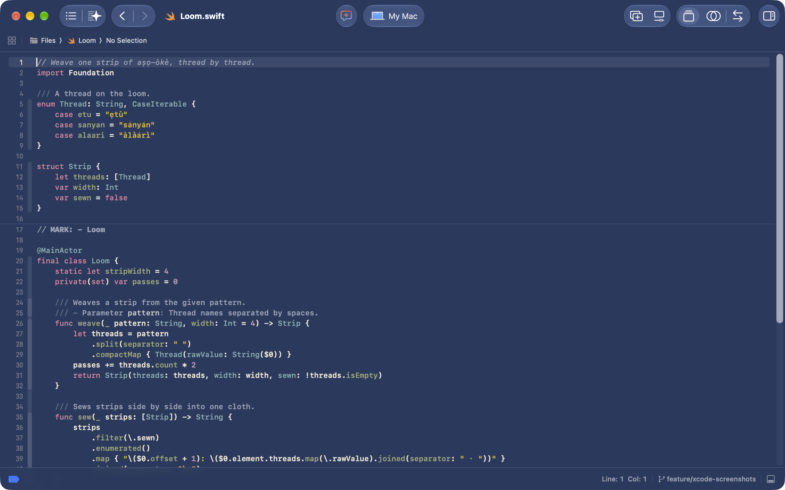
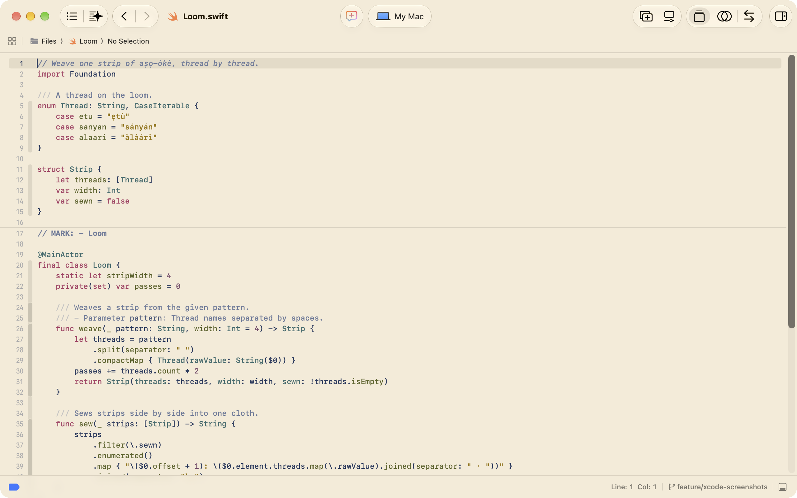

# Ilé-Ọ̀yọ́ for Xcode

Two source editor themes:

| File | Variant |
| ---- | ------- |
| `Ile-Oyo-Ale.xccolortheme` | **Alẹ́** (evening), dark |
| `Ile-Oyo-Osan.xccolortheme` | **Ọ̀sán** (afternoon), light |

## Install

1. Download `Ile-Oyo-Ale.xccolortheme` and `Ile-Oyo-Osan.xccolortheme` (from
   a GitHub release, or this folder).
2. In Xcode, open **Settings → Appearance**, then the **Themes** tab.
3. Click **Choose…**, then **Import…**, and select a downloaded file. Repeat
   for the other variant.
4. Select **Ile-Oyo-Ale** or **Ile-Oyo-Osan**. Xcode keeps one theme for
   light mode and one for dark mode, and tints its window to match.

Checked in Xcode 27.2. Copying the files into
`~/Library/Developer/Xcode/UserData/FontAndColorThemes/` alone isn't enough
there; import them as above.

## What's in each theme

- The source editor: background, text, selection, cursor, current line,
  invisibles, and every Xcode syntax type (keywords, strings, types,
  functions, macros, attributes, doc comments and more).
- The console and the documentation (markup) colors.
- Fonts: SF Mono Medium 12 pt, with italic comments, as in Xcode's defaults.
  Change the font or size in Xcode's settings; the colors stay.
- Every syntax color reaches WCAG AA contrast (4.5:1) against the background.

These files are generated from `palette/ile-oyo.json` by `npm run build`.
Don't edit them by hand; change the palette and rebuild.
`npm run screenshot:xcode -- ale` (or `osan`) retakes a screenshot of the
theme that's selected in Xcode.
