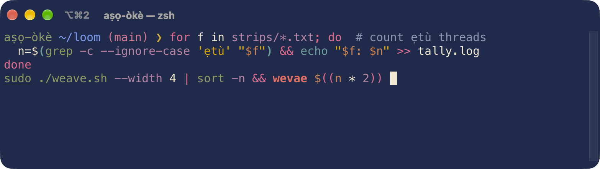
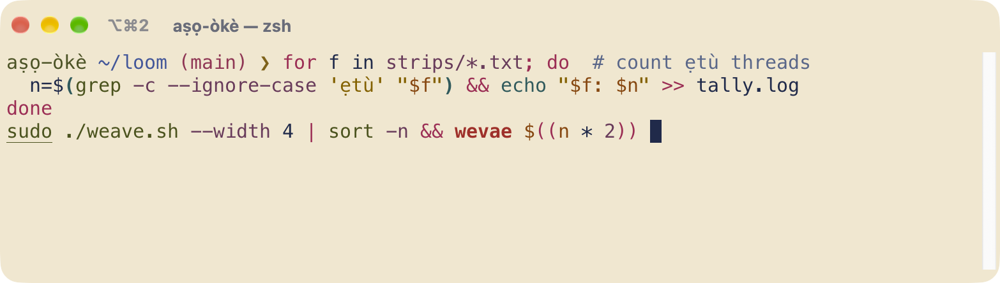

# Ilé-Ọ̀yọ́ for Zsh

Colors for what you type at the zsh prompt, one file per variant, for the two
common highlighting plugins:

| Plugin | Alẹ́ (dark) | Ọ̀sán (light) |
| ------ | ----------- | ------------- |
| [zsh-syntax-highlighting](https://github.com/zsh-users/zsh-syntax-highlighting) (+ [zsh-autosuggestions](https://github.com/zsh-users/zsh-autosuggestions)) | `ile-oyo-ale.zsh` | `ile-oyo-osan.zsh` |
| [fast-syntax-highlighting](https://github.com/zdharma-continuum/fast-syntax-highlighting) | `fast-syntax-highlighting/ile-oyo-ale.ini` | `fast-syntax-highlighting/ile-oyo-osan.ini` |





The screenshots use fast-syntax-highlighting in iTerm2 with the Ilé-Ọ̀yọ́
iTerm2 colors; zsh-syntax-highlighting uses the same colors.

Pick the variant that matches your terminal's background. The files work
with any terminal theme, but they look best with Ilé-Ọ̀yọ́'s own terminal
colors (see [iTerm2](../iterm/)).

## Install

The files are in this folder and in
[GitHub Releases](https://github.com/ayoolaao/ile-oyo-theme/releases).

**zsh-syntax-highlighting**: source the file in `~/.zshrc` *after* the plugin:

```zsh
source /path/to/zsh-syntax-highlighting.zsh
source /path/to/ile-oyo-ale.zsh
```

It also sets the zsh-autosuggestions color
(`ZSH_AUTOSUGGEST_HIGHLIGHT_STYLE`), so suggestions show in the comment color.

**fast-syntax-highlighting**: load the theme once; it stays selected in new
shells:

```zsh
fast-theme /path/to/ile-oyo-ale.ini
```

If you use zsh-autosuggestions, add this to `~/.zshrc` (Alẹ́; for Ọ̀sán use
`#576788`):

```zsh
ZSH_AUTOSUGGEST_HIGHLIGHT_STYLE='fg=#8994AA'
```

Colors are 24-bit. In terminals without 24-bit color, zsh picks the nearest
of 256 colors (the `.zsh` file and fast-syntax-highlighting load
`zsh/nearcolor` for this).

## What's colored

- Keywords (`if`, `for`, `do`), operators and separators (`&&`, `|`, `;`,
  `>>`) in pink; commands and functions in green; builtins and aliases in
  cyan.
- Strings in yellow, `$variables` in orange, escapes in pink, numbers and
  options in purple, globs (`*.txt`) in purple, paths underlined.
- Comments in the comment color; unknown commands in bold red.
- Every color reaches WCAG AA contrast (4.5:1) against the variant's
  background.

The files are generated from `palette/ile-oyo.json` by `npm run build`. Don't
edit them by hand; change the palette and rebuild. `npm run screenshot:zsh`
retakes the screenshots without touching your `~/.zshrc` or your active
fast-syntax-highlighting theme.
